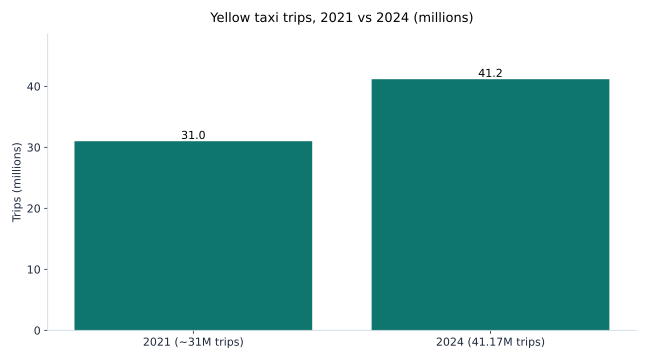
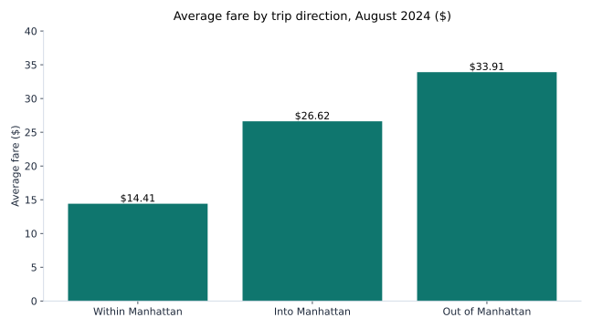

# NYC Yellow Taxi Demand Analysis

I live next to New York City, and I wanted to see when yellow taxis are busiest here, and what a ride actually costs. So I took the city's own taxi trip records and worked through them myself.

I am a data analyst. I worked at JEEVIKA in Bihar, India for 3 years, and I have an M.S. in Information Systems from Rider University. This is a portfolio project on public data.

## What I found

2024 was a big year for yellow taxis. They did 41,169,638 trips, up 19% from 2023. Total farebox money was $965,887,028.

Compare that to 2021. Back then it was just over $486 million across almost 31 million trips. So trips and money both came back strong.

There were 13,587 medallion taxicabs licensed in 2024. 10,870 of them were active. The average farebox per driver was $48,698.

January 2024 alone had 2,964,624 yellow taxi trips.

## What a trip costs

I looked at one published analysis of August 2024 trips. A ride inside Manhattan is short and cheap. A ride out of Manhattan costs more, even though it is shorter than a ride in.

- Inside Manhattan: 2.16 miles, $14.41, 13.17 minutes
- Into Manhattan: 4.47 miles, $26.62, 21.09 minutes
- Out of Manhattan: 3.57 miles, $33.91, 22.54 minutes

In that same August file, Midtown Center had the most pickups, with 44,892. Green taxis were only about 2% of taxi trips.

## The data

The data comes from the NYC Taxi and Limousine Commission (TLC). They publish trip records every month, free, no account needed. The files go back to 2009.

Each row is one trip. It has pickup and dropoff times, passenger count, trip distance, fare, tip, tolls, payment type, and pickup and dropoff zone. There are 260 taxi zones in the city.

I used the January 2024 yellow taxi file. See `data/DATA_SOURCE.md` for where to get it. The dataset itself is not in this repo.

## How I cleaned it

Real data is messy. I dropped:

- Trips with a negative fare or negative total. Those are typing errors.
- Trips with zero distance. Those are GPS failures or cancelled rides.
- Trips longer than 3 hours. That is almost always a meter left running.

One published pipeline dropped about 4.5% of rows as bad data. My notebook does the same kind of cleaning.

In the August 2024 analysis, the raw file had about 3 million rows. The team there used a 1-million-row random sample. 859,762 rows were left after cleaning.

## How to run it

1. Download the January 2024 yellow taxi parquet file. See `data/DATA_SOURCE.md`.
2. Put it in `data/`.
3. Run `pip install -r requirements.txt`
4. Open `notebooks/01-taxi-demand-analysis.ipynb` and run it top to bottom.
5. The SQL version of the same questions is in `sql/taxi_queries.sql`. It works with DuckDB or Postgres.

## What this does not show

- One month is a snapshot. January is not the whole year, and demand changes by season.
- The tip column only records card tips. Cash tips are not in the data.
- The trip data comes from the taxi technology providers, not from the TLC itself.
- The full-year trip and farebox totals come from the TLC annual report. I did not add up one month's file to get them.

## Tools

- Python (pandas, matplotlib, pyarrow)
- SQL (DuckDB / Postgres)
- Jupyter

## About me

Lovely Kumari. Data Analyst, Jersey City, NJ. M.S. in Information Systems, Rider University. I worked as a Data Analyst at JEEVIKA in Bihar, India, where I built Power BI dashboards for 3,500+ Self-Help Groups.
